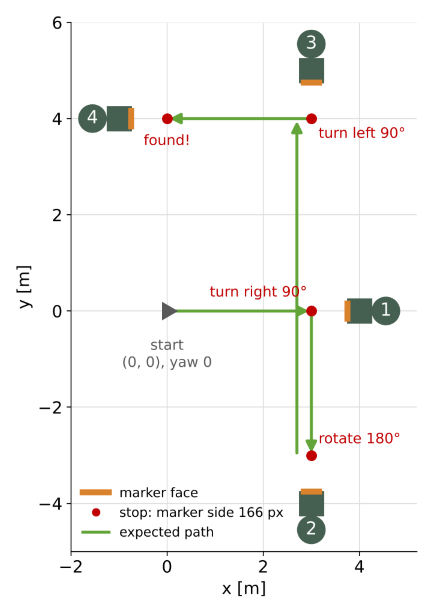
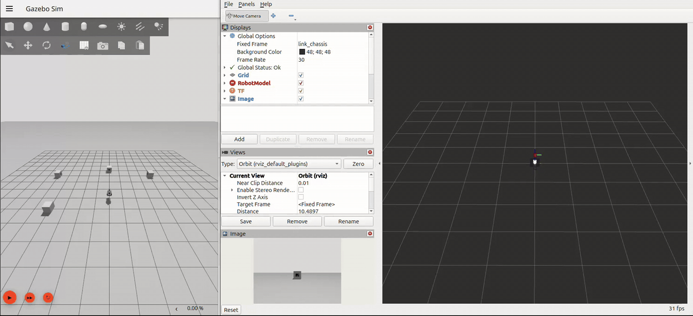
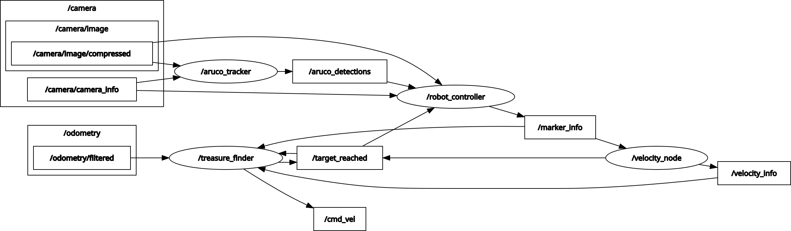

 # ArUco Treasure Hunt

The assignment involves programming a robot to take part in a treasure hunt.

There are four ArUco markers to reach in order; the robot must stop approximately 50 cm from each marker; the marker’s ID will provide the instruction to continue along the route.

<div align="center">
    
    <br>
    <p>Figure 1: map showing ArUco's positions</p>
</div>

*(\*) The robot is initially positioned so that it faces marker **1** directly.*

---

# Architectures

## Nodes

The programme is divided into three nodes. The following names of the topics used in the README reflect the remapped names (as shown in the various yaml files)

### 1. marker_display_node (.py)
It is responsible for sensing the environment. It receives images from the `/camera/camera_info` and detects markers using the `/aruco_detections` topic.

The target is visually seen with a red circle and the marker's ID. This image is published on the `/marker_image` topic. To ensure that the robot follows the correct sequence of the markers, it analyses the marker IDs received from the `/target_reached` topic. 

The information from `/target_reached` provides two critical checks:  
- First: it appends the marker_array parameter. This ensures that if the camera detects the marker again, it will ignore it. 
- Second: if the robot reaches the marker and it matches the current seen marker, it stops publishing the red circle on `/marker_image`. 

How the `/custom_msg` is validated before sending to the velocity node:
- A check is required in the case of duplicate-detected markers, if no marker is detected, or if the detected marker ID is out of the sequential numerical order. 
- If all the above are false, the custom message is compiled.

It calculates the marker’s apparent dimensions in pixels considering radius $r$, extracts its 3D coordinates (x, y, z) and converting them to the corresponding 2D values by projecting the coordinates onto the image plane:

$$u = f_x \frac{X}{Z} + c_x$$

$$v = f_y \frac{Y}{Z} + c_y$$

where:
- **$(u, v)$**: 2D pixel coordinates of the marker center in the image (`cx`, `cy`)
- **$(X, Y, Z)$**: 3D position of the marker relative to the camera frame (with $Z$ representing depth `d`)
- **$f_x, f_y$**: focal lengths in pixels ($K_{0,0}$ and $K_{1,1}$)
- **$c_x, c_y$**: optical center coordinates in pixels ($K_{0,2}$ and $K_{1,2}$)

Finally, it sends a custom message on the **/custom_msg** topic containing the marker’s 2D coordinates (`cx`, `cy`), the depth `d` ($Z$), and its ID.


### 2. velocity (.cpp)

This is the node responsible for calculating the Visual Servoing.

By subscribing to the `/marker_info` topic, it **extracts the marker's `id`, 2D pixel center (`cx`, `cy`), and distance `d`** to calculate the correct angular and linear velocities needed to center the marker and reach the desired proximity.

Before publishing, the node checks the proximity condition ($d < 0.5\text{ m}$): if the target distance has been reached, it forces both velocities to zero ($v = 0, \omega = 0$) and publishes the reached `id` to the `/target_reached` topic; otherwise, it sends the computed commands to the `/velocity_info` topic.

#### The formulas used to compute the error are the following:

* To determine the desired marker size 

    $$s_d = \frac{f \cdot L}{d}$$

    * **$s_d$**: desired size of the marker’s side in the image (166 px)
    * **$f$**: focal length of the camera (px, derived from the `camera_info` calibration parameters)
    * **$L$**: actual physical dimension of the marker’s side (m)
    * **$d$**: desired distance to maintain from the marker (about 0.5 m) 

* To determine the angular velocity 

    $$\omega = -k_\omega \cdot (u - c_x)$$

    * **$\omega$**: angular velocity commanded to the robot ($\text{rad/s}$)
    * **$k_\omega$**: proportional gain for angular control
    * **$u$**: horizontal coordinate (px) of the centre of the detected marker
    * **$c_x$**: horizontal coordinate (px) of the centre of the image 

* To determine the linear velocity 

    $$v = k_v \cdot (s_d - s)$$

    * **$v$**: linear velocity commanded to the robot ($\text{m/s}$)
    * **$k_v$**: proportional gain for linear control
    * **$s_d$**: desired size of the marker’s side (px)
    * **$s$**: current apparent size of the detected marker side (px) 

### 3. treasure_finder (.py)

This node coordinates the robot’s actual movement.

It subscribes to the visual servoing commands on `/velocity_info`, the robot's rotation from the EKF output on `/odometry/filtered`, the current marker data on `/marker_info`, and the triggers on `/target_reached`. 

It estimates the robot’s true orientation (yaw) by converting the odometry quaternion $(x, y, z, w)$:

$$\psi = \text{atan2}\left(2(w z + x y), \; 1 - 2(y^2 + z^2)\right)$$

During normal operation, the node passes the visual servoing commands from `/velocity_info` directly to the robot's wheels via `/cmd_vel`. If no valid marker is seen, it acts as a safety fallback and drives the robot straight ahead to search for one. 

Once the vision part signals that a target has been reached on `/target_reached`, the node extracts the marker ID, ignores commands for any markers it has already visited, and executes the correct rotation:

| Marker ID | Command |
| :---: | :--- |
| **1** | Turn **right** by 90°, then go straight ahead |
| **2** | Rotate by **180°**, then go straight ahead |
| **3** | Turn **left** by 90°, then go straight ahead |
| **4** | **Stop**: the hunt is over |

#### State machine
The node cycles between three states (`SERVOING`, `ROTATING`, `STOPPED`). During `SERVOING`, it forwards `/velocity_info` commands or drives straight. Once a new target is reached, it takes over control and switches to `ROTATING` to complete the closed-loop maneuver using `/odometry/filtered`. After the error drops below a threshold and the rotation is complete, it publishes **`id = 0`** to `/target_reached` to reset the vision part, and returns to `SERVOING`.

## Topic

The following table summarizes the main topics used across the nodes to manage perception, visual servoing, and navigation:

| Topic | Message Type | Publisher | Subscriber | Description |
| :--- | :--- | :--- | :--- | :--- |
| **`/camera/image/compressed`** | `sensor_msgs/msg/CompressedImage` | `/ros_gz_image` | `/aruco_tracker`, `/robot_controller` | Raw compressed camera stream from the environment |
| **`/camera/camera_info`** | `sensor_msgs/msg/CameraInfo` | `/ros_gz_bridge` | `/aruco_tracker`, `/robot_controller` | Camera intrinsic parameters ($K$ matrix) for 3D-to-2D projection |
| **`/aruco_detections`** | `aruco_opencv_msgs/msg/ArucoDetection` | `/aruco_tracker` | `/robot_controller` | Detected ArUco marker IDs and 3D poses |
| **`/marker_image`** | `sensor_msgs/msg/CompressedImage` | `/robot_controller` | RViz2 | Debug image highlighting the active target with a bounding circle and ID |
| **`/marker_info`**  **`/custom_msg`** | `custom_msgs/msg/Box` | `/robot_controller` | `/velocity_node`, `/treasure_finder` | Custom message containing target `id`, 2D center (`cx`, `cy`), and depth `d` |
| **`/velocity_info`** | `geometry_msgs/msg/Twist` | `/velocity_node` | `/treasure_finder` | Computed linear and angular velocities for visual servoing alignment |
| **`/target_reached`** | `std_msgs/msg/Int32` | `/velocity_node`, `/treasure_finder` | `/robot_controller`, `/treasure_finder` | Reached marker ID (used to trigger rotations and reset state with `0`) |
| **`/odometry/filtered`** | `nav_msgs/msg/Odometry` | `/ekf_filter_node` | `/treasure_finder` | Filtered robot pose and orientation used to control rotations |
| **`/cmd_vel`** | `geometry_msgs/msg/Twist` | `/treasure_finder` | `/ros_gz_bridge` | Final velocity commands sent to move the robot |

### Topic Remapping

To allow modular communication without topic conflicts (for instance, separating the visual servoing velocities from the final robot commands), several default parameter names declared inside the nodes are remapped at launch time via YAML configuration files:

| Node | Default Topic | Remapped Topic | Role |
| :--- | :--- | :--- | :--- |
| **`robot_controller`** | `custom_msg` | **`/marker_info`** | Output marker data (`Box`) |
| **`velocity_node`** | `cmd_vel` | **`/velocity_info`** | Output visual servoing velocities |
| **`velocity_node`** | `feedback_info` | **`/target_reached`** | Output reached marker ID |

---

# Simulation

Below is a preview of the simulation played at 3x speed, the original `.mp4` recording is available in `readme_img/simulation.mp4`

<div align="center">
    
    <br>
    <p>Video 1: Gazebo and RViz simulation (3x speed)</p>
</div>

The ROS 2 computation graph below (`rqt_graph`) illustrates the main active nodes and their topic connections

<div align="center">
    
    <br>
    <p>Figure 2: filtered `rqt_graph` showing the main nodes and topics.</p>
</div>

---

# Requirements

Operating System: Ubuntu (suggested: 24.04)
ROS 2: suggested distribution Jazzy
Standard ROS 2 tools:
* `colcon`
* Gazebo
* Rviz 


To install **Gazebo and Rviz**:
```
# install Gazebo Harmonic (for Jazzy)
sudo apt update
sudo apt install ros-jazzy-ros-gz

# install RViz2
sudo apt install ros-jazzy-rviz2
```
To install **robot localization** package:
```
sudo apt install ros-jazzy-robot-localization
```

# Running the simulation

Clone the repository (selecting the desired branch) inside the `src` folder of your ROS 2 workspace:
```bash
git clone -b main https://github.com/TZTozz/Experimental.git
```

Move to the root of the workspace, build and source the environmet:
```bash
colcon build
source install/setup.bash
```

Using the launch file to run the simulation:
```bash
ros2 launch erl1 spawn_assignment.launch.py
```

## Authors
This project was developed as a collaborative group project for the Expertimental Robotics course in Robotics Engineering Master's Degree at the University of Genova.
<div align="center">
   <a href="https://github.com/Stef504"></a>
  &nbsp;&nbsp;&nbsp;&nbsp;
  <a href="https://github.com/Chiaera"></a>
  &nbsp;&nbsp;&nbsp;&nbsp;
   <a href="https://github.com/TZTozz"></a>
  &nbsp;&nbsp;&nbsp;&nbsp;
   <a href="https://github.com/Mat-Muz"></a>
  &nbsp;&nbsp;&nbsp;&nbsp;
   <a href="https://github.com/AndreaLaura-23"></a>
</div>