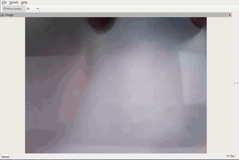
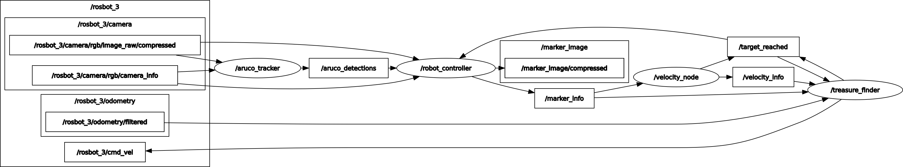

# ArUco Treasure Hunt - Real Robot

For the sake of clarity, this README covers only the differences between the **simulation** and testing on the **real robot** (ROSbot).
For general architecture details and control formulas, please refer to the README in the `main` branch.

---

# Architectures

## Nodes

The division into the three main nodes has been preserved:
- **Node 1 (`marker_image.py`)**: senses the environment and projects marker coordinates
- **Node 2 (`velocity.cpp`)**: computes Visual Servoing velocities
- **Node 3 (`treasure_finder.py`)**: coordinates navigation and state transitions

**Unlike the simulation**, a speed clamping function has been added to `treasure_finder` to ensure smooth and safe motion on the physical robot.

## Topic

The following table summarizes the main topics used on the real robot (ROSbot used: `ROS_DOMAIN_ID=13`, namespace `/rosbot_3`):

| Topic | Message Type | Publisher | Subscriber | Description |
| :--- | :--- | :--- | :--- | :--- |
| **`/rosbot_3/camera/rgb/image_raw/compressed`** | `sensor_msgs/msg/CompressedImage` | ROSbot Camera Driver | `/aruco_tracker`, `/robot_controller` | Raw compressed RGB camera stream from the robot |
| **`/rosbot_3/camera/rgb/camera_info`** | `sensor_msgs/msg/CameraInfo` | ROSbot Camera Driver | `/aruco_tracker`, `/robot_controller` | Camera intrinsic parameters ($K$ matrix) for 3D-to-2D projection |
| **`/aruco_detections`** | `aruco_opencv_msgs/msg/ArucoDetection` | `/aruco_tracker` | `/robot_controller` | Detected ArUco marker IDs and 3D poses |
| **`/marker_image/compressed`** | `sensor_msgs/msg/CompressedImage` | `/robot_controller` | RViz2 | Debug image highlighting the active target with a bounding circle and ID |
| **`/marker_info`** | `custom_msgs/msg/Box` | `/robot_controller` | `/velocity_node`, `/treasure_finder` | Custom message containing target `id`, 2D center (`cx`, `cy`), and depth `d` |
| **`/velocity_info`** | `geometry_msgs/msg/Twist` | `/velocity_node` | `/treasure_finder` | Computed linear and angular velocities for visual servoing alignment |
| **`/target_reached`** | `std_msgs/msg/Int32` | `/velocity_node`, `/treasure_finder` | `/robot_controller`, `/treasure_finder` | Reached marker ID (used to trigger rotations and reset state with `0`) |
| **`/rosbot_3/odometry/filtered`** | `nav_msgs/msg/Odometry` | `/ekf_filter_node` | `/treasure_finder` | Filtered robot pose and orientation used to control rotations |
| **`/rosbot_3/cmd_vel`** | `geometry_msgs/msg/Twist` | `/treasure_finder` | ROSbot Controller | Final velocity commands sent to move the physical robot |

### Topic Remapping

Compared to the simulation, the hardware driver topics are remapped to match the physical robot's `/rosbot_3` namespace (camera RGB streams and `/rosbot_3/cmd_vel`) as in the above table, while the internal communication topics between the three nodes (`/marker_info`, `/velocity_info`, `/target_reached`) remain **unchanged**.

---

# Real Robot Test

Below is a preview of the test played at 3x speed, the original `.mp4` recordings are available in the `media/` folder.
The robot used for testing is **Robot 13** (`/rosbot_3`).

<div align="center">
  <table>
    <tr>
      <td align="center" width="40%">
        
        <br>
        <p>Video 1: video of what <code>/rosbot_3/camera/rgb/image_raw/compressed`</code> sees (3x speed)</p>
      </td>
      <td align="center" width="60%">
        
        <br>
        <p>Video 2: video of the test on the robot (3x speed)</p>
      </td>
    </tr>
  </table>
</div>

The ROS 2 computation graph below (`rqt_graph`) illustrates the main active nodes and their topic connections:

<div align="center">
  
  <br>
  <p>Figure 1: filtered <code>rqt_graph</code> showing the main nodes and topics.</p>
</div>

---

 # Requirements

**Operating System**: Ubuntu (suggested: 24.04)
**ROS 2**: suggested distribution Jazzy
**Standard ROS 2 tools**:
* `colcon`
* Gazebo
* Rviz 


To install **Gazebo and Rviz**:
```
# install Gazebo Harmonic (for Jazzy)
sudo apt update
sudo apt install ros-jazzy-ros-gz

# install RViz2
sudo apt install ros-jazzy-rviz2
```

To install **robot localization** package:
```
sudo apt install ros-jazzy-robot-localization
```

# Running using the Real Robot

To try the code on the real robot you need to be connected to the Connect to lab wiFi (**RICE WiFi**).
Every robot has a ID (to substitute in robot_ID in the fellow code) write over, you need that number for connecting to the robot:

```
export ROS_DOMAIN_ID= robot_ID

#to verify the connection
echo $ROS_DOMAIN_ID 
```

Clone the repository (selecting the desired branch) inside the `src` folder of your ROS 2 workspace:
```bash
git clone -b Lab_setup https://github.com/TZTozz/Experimental.git
```

Move to the root of the workspace, build and source the environmet:
```bash
colcon build
source install/setup.bash
```

Using the launch file to run the simulation:
```bash
ros2 launch erl1 spawn_assignment.launch.py
``` 